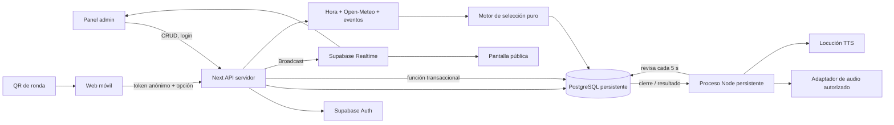
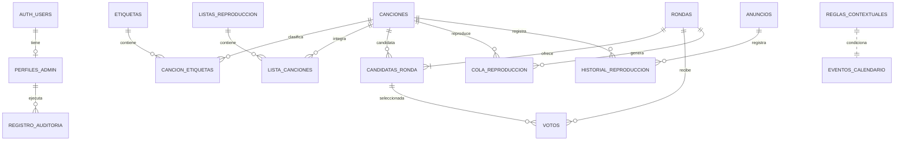

# Arquitectura y modelo de datos

## Flujo

**Autoridad:** el servidor asigna las fechas de apertura y cierre. `registrar_voto` bloquea la fila de ronda, valida vigencia y opción, aplica límite IP y unicidad por dispositivo. `cerrar_ronda_vencida` cuenta votos y persiste ganador/desempate en una transacción. La pantalla calcula un contador visual desde `cierra_en`, sin autoridad de cierre local.

**Tiempo real:** los endpoints publican `estado_actualizado` en el canal `radio-publica`; la pantalla se suscribe y también recupera mediante consultas periódicas. El canal no contiene identidad del votante. Las lecturas de totales salen de la API de servidor.

**Selección pura:** `src/lib/seleccion.ts` filtra canciones activas, autorizadas y no explícitas, aplica la regla activa de mayor prioridad, evita las últimas reproducciones y entrega razones por candidata. La lista de respaldo solo se consulta después de excluir la ventana reciente; el respaldo también debe tener permiso verificado.

## Entidades principales

| Tabla | Propósito |
|---|---|
| `perfiles_admin` | Rol y habilitación del usuario de Supabase Auth. |
| `canciones`, `etiquetas`, `cancion_etiquetas` | Catálogo y atributos de contexto. |
| `listas_reproduccion`, `lista_canciones` | Colecciones ordenadas administrables. |
| `reglas_contextuales`, `eventos_calendario`, `configuracion` | Contexto y parámetros persistentes. |
| `rondas`, `candidatas_ronda`, `votos` | Votación, razones, conteo y resultado. |
| `limites_voto` | Limitación temporal por señal IP protegida. |
| `cola_reproduccion`, `historial_reproduccion` | Cola propuesta y registro de eventos del reproductor. |
| `anuncios` | Texto, aprobación, vigencia y programación de anuncios. |
| `registro_auditoria` | Cambios de administración. |

Todas las tablas usan RLS. Las escrituras administrativas y RPCs de voto solo se ejecutan desde servidor con `service_role`, nunca desde el navegador. Las claves privadas no llevan prefijo `NEXT_PUBLIC_`.
